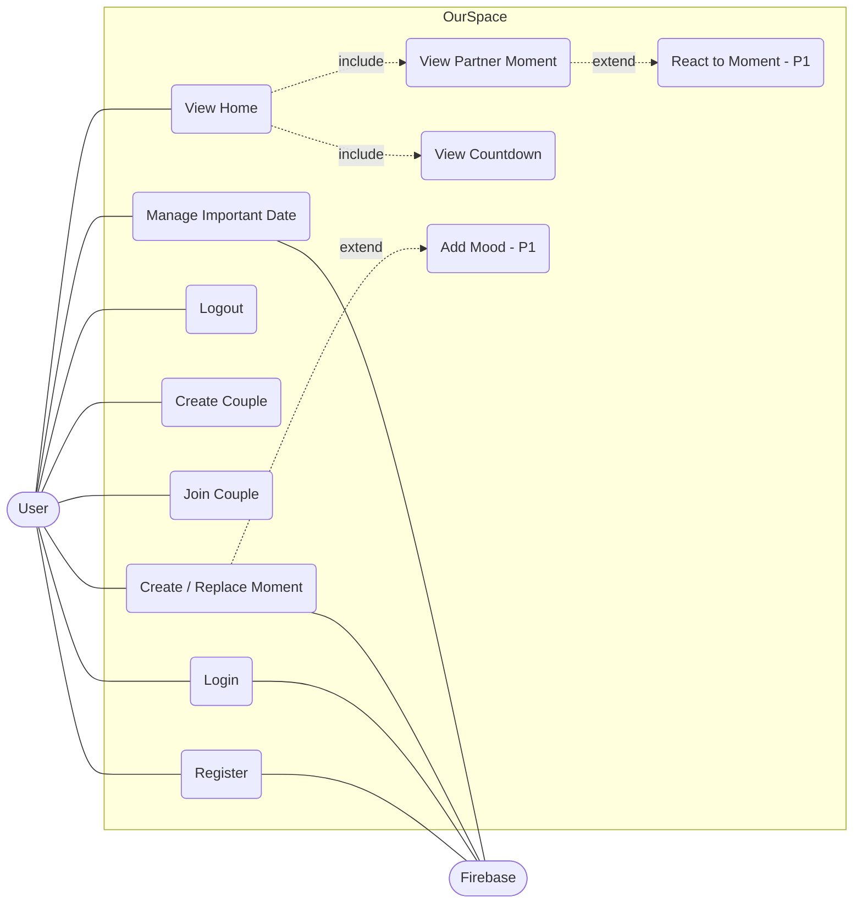

# 03 — Use Case

Aktor: **User** (dan Partner), **Firebase** (sistem eksternal).

| ID | Use Case | Prioritas |
|---|---|---|
| UC-01 | Register | P0 |
| UC-02 | Login | P0 |
| UC-03 | Logout | P0 |
| UC-04 | Create Couple | P0 |
| UC-05 | Join Couple | P0 |
| UC-06 | View Home | P0 |
| UC-07 | Create/Replace Moment | P0 |
| UC-08 | View Partner Moment | P0 |
| UC-09 | Manage Important Date (list/add/edit/delete) | P0 |
| UC-10 | View Countdown | P0 |
| UC-11 | Add Mood | P1 |
| UC-12 | React to Moment | P1 |
| UC-13 | Manage Profile | P1 |
| UC-14 | Manage Reminder | P1 |

## Deskripsi

**UC-01 Register** — Pre: belum punya akun. Alur: isi nama, email, password → akun dibuat → dokumen `users/{uid}` dibuat. Alt: email sudah dipakai / password lemah → error. Post: login, ke Couple Setup.

**UC-02 Login** — Alur: email+password → sukses → cek `coupleId` di profil: ada → Home, tidak → Couple Setup. Alt: kredensial salah → error. Post: sesi tersimpan.

**UC-03 Logout** — Tekan Logout → sesi dihapus → Login.

**UC-04 Create Couple** — Pre: login, belum punya couple (BR-01). Alur: sistem membuat `couples/{id}` (`memberA=uid`), kode 6 karakter unik, `invites/{kode}`, simpan `coupleId` di profil → tampilkan kode. Post: menunggu member kedua.

**UC-05 Join Couple** — Pre: login, belum punya couple. Alur: input kode → baca `invites/{kode}` → transaksi: pastikan `memberB` kosong → isi `memberB`, simpan `coupleId` di profil → Home. Alt: kode tidak ada; couple penuh (BR-02); user sudah punya couple → ditolak.

**UC-06 View Home** — Pre: dalam Couple Space. Tampil moment sendiri, moment partner (realtime), upcoming date + countdown. Alt: empty state untuk moment/tanggal kosong; status "menunggu pasangan" jika `memberB` kosong.

**UC-07 Create/Replace Moment** — Pre: dalam Couple Space. Alur: kamera/galeri → preview → caption → Post → resize+kompres → `set` ke `moments/{uid}` (menimpa). Alt: izin kamera ditolak → galeri; kompres masih >400 KB → turunkan kualitas; jaringan gagal → error, moment lama utuh. Post: hanya satu moment aktif.

**UC-08 View Partner Moment** — Listener Firestore → tampil foto, caption, timestamp. Alt: partner belum posting → placeholder.

**UC-09 Manage Important Date** — Pre: dalam Couple Space. Lihat daftar → tambah (title, date, recurring) / edit / hapus dengan konfirmasi. Kedua member boleh mengelola. Alt: title kosong / tanggal tidak valid → validasi.

**UC-10 View Countdown** — Hitung kejadian terdekat ke depan; recurring yang lewat → tahun berikutnya; non-recurring yang lewat diabaikan. Dihitung di perangkat dari tanggal hari ini (BR-13).
