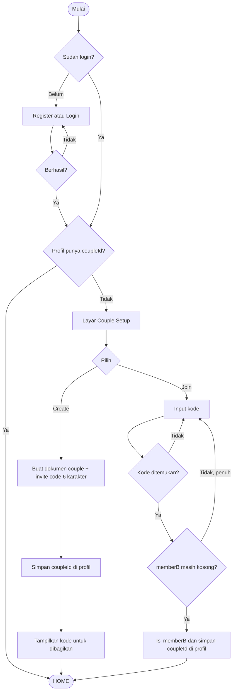
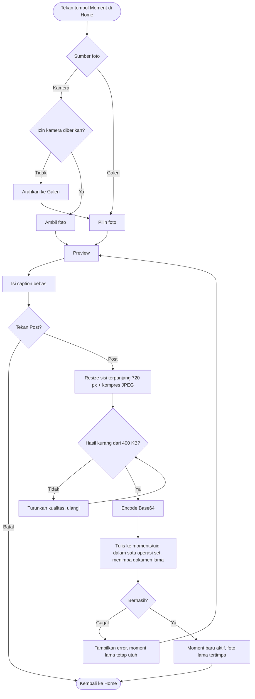
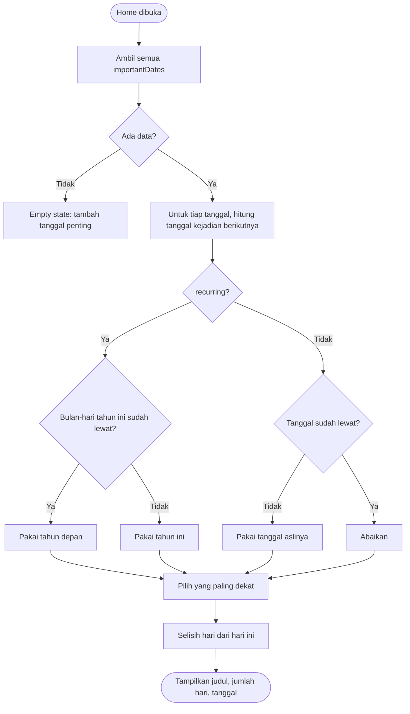

# 04 — Activity Diagram

## AD-01 Couple Setup (UC-01..05)

Catatan: setelah Create, user A langsung masuk Home; Home menampilkan "menunggu pasangan". Kode undangan tetap bisa dilihat di Settings.

## AD-02 Create/Replace Moment (UC-07)

## AD-03 Countdown (UC-10)

Edge case wajib diuji: hari ini = tanggal event → "0 hari / Hari ini"; 29 Februari recurring → 28 Februari di tahun non-kabisat.
