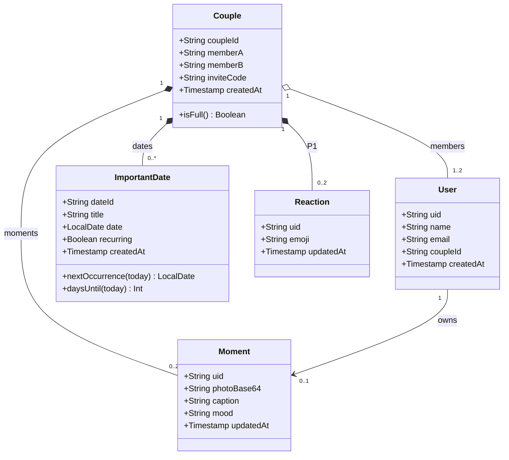
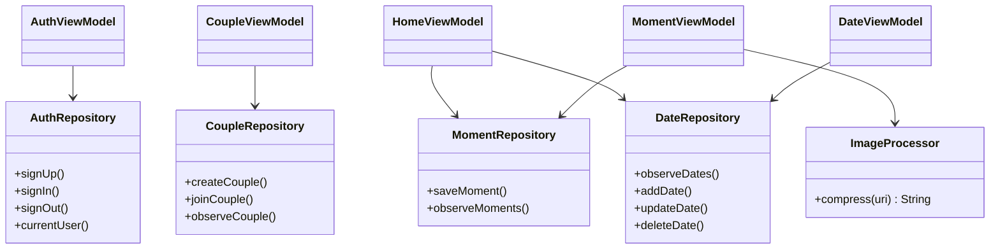
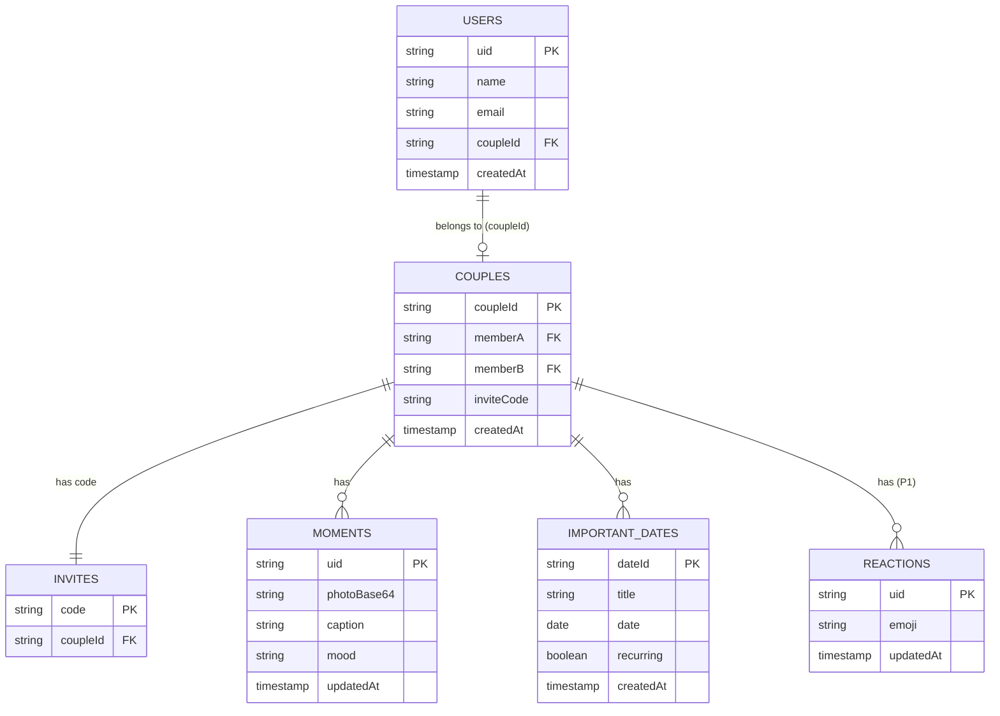

# 06 — Data Model

## Struktur Firestore (final)
```text
users/{uid}
    name, email, coupleId, createdAt

invites/{code}
    coupleId

couples/{coupleId}
    memberA, memberB, inviteCode, createdAt
    ├── moments/{uid}
    │       photoBase64, caption, mood?, updatedAt
    ├── importantDates/{dateId}
    │       title, date, recurring, createdAt
    └── reactions/{uid}            (P1)
            emoji, updatedAt
```
- `mood` opsional (P1). `reactions` P1. Field `reminder` ditambah bersama fitur Reminder (D-12).
- `date` disimpan sebagai tanggal saja (mis. string `2026-10-25`), bukan Timestamp (D-07).
- Foto: Base64 JPEG, sisi terpanjang 720 px, target ±250 KB, batas keras 400 KB (D-03).
- Moment/Reaction dipisah dokumen agar perubahan reaksi tidak mengunduh ulang foto.

## Class Diagram — domain


## Class Diagram — arsitektur


## ERD konseptual


## Matriks akses (dasar Security Rules)
| Path | Read | Write |
|---|---|---|
| `users/{uid}` | pemilik | pemilik |
| `invites/{code}` | `get` user login; `list` ditolak | create saat membuat couple |
| `couples/{cid}` | member (atau `get` bila slot `memberB` masih kosong, untuk Join) | create oleh `memberA`; update hanya untuk mengisi `memberB` |
| `couples/{cid}/moments/{uid}` | member | hanya pemilik uid, dengan batas ukuran |
| `couples/{cid}/importantDates/{id}` | member | member |
| `couples/{cid}/reactions/{uid}` (P1) | member | hanya pemilik uid |

Batasan yang diketahui: aturan "satu user hanya satu couple" tidak bisa ditegakkan penuh oleh Rules
(lintas dokumen); ditegakkan di transaksi client. Untuk dua pengguna, risiko ini diterima.
