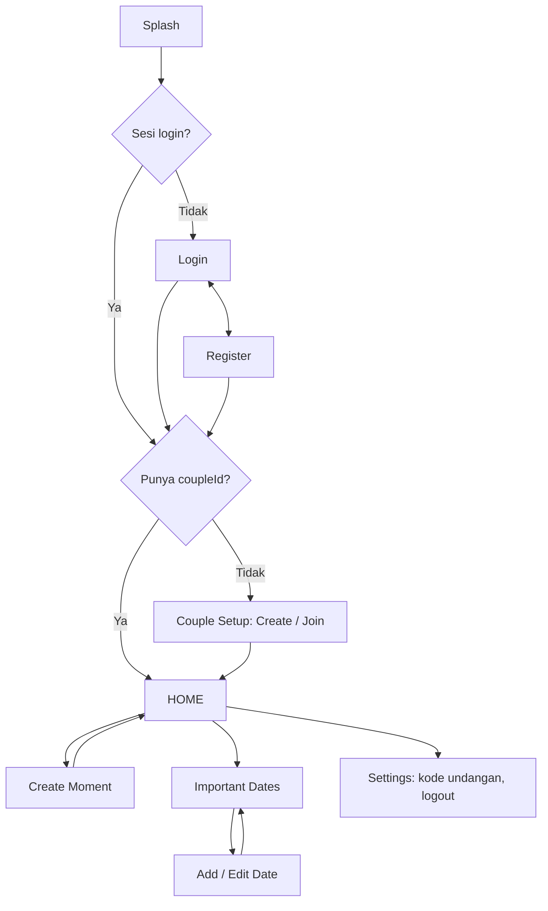

# 07 — Arsitektur dan UI Flow

## Arsitektur
```text
UI (Compose)  →  ViewModel  →  Repository  →  Firebase (Auth, Firestore)
   Screen          StateFlow       Result<T> / Flow
```
- Satu `UiState` per layar via `StateFlow`; layar hanya membaca state dan memanggil fungsi ViewModel.
- Repository mengembalikan `Result<T>` atau `Flow`; tidak melempar exception ke UI.
- Tanpa Hilt/DI framework; satu modul Gradle `app` (D-09, Proposed).
- Satu Activity (`MainActivity`) dengan NavHost.

## Struktur paket
```text
com.<paket>.ourspace/
├── MainActivity.kt
├── navigation/NavGraph.kt
├── data/
│   ├── model/        User, Couple, Moment, ImportantDate
│   └── repository/   AuthRepository, CoupleRepository, MomentRepository, DateRepository
├── util/             ImageProcessor.kt, DateUtils.kt
└── ui/
    ├── theme/
    ├── splash/
    ├── auth/         LoginScreen, RegisterScreen, AuthViewModel
    ├── couple/       CoupleSetupScreen, CoupleViewModel
    ├── home/         HomeScreen, HomeViewModel
    ├── moment/       CreateMomentScreen, MomentViewModel
    ├── dates/        DatesScreen, AddEditDateScreen, DateViewModel
    └── settings/     SettingsScreen (P1: nama, kode undangan, Logout)
```

## Dependensi yang diizinkan (D-13)
Compose + Material 3 · Navigation Compose · Firebase BoM (Auth, Firestore) · Coroutines/Flow.
Foto Base64 di-decode manual ke `Bitmap` (tanpa Coil). **Tanpa Firebase Storage/Analytics.**

## UI Flow

Perubahan dari rencana awal (D-10, Proposed): tanpa bottom nav, Moment Detail dihapus, Profile digabung ke Settings.

## Wireframe Home
```text
┌────────────────────────────┐
│  OUR SPACE            ⚙    │
├────────────────────────────┤
│ ┌────────────────────────┐ │
│ │     FOTO PARTNER       │ │
│ └────────────────────────┘ │
│  "lagi makan nih hehe"     │
│  2 jam lalu                │
│                            │
│ ┌────────────────────────┐ │
│ │      FOTO SAYA         │ │
│ └────────────────────────┘ │
│  "akhirnya kelar tugas"    │
│  [ Ganti Moment ]          │
│ ───────────────────────── │
│   ❤️ OUR NEXT DATE         │
│   ANNIVERSARY              │
│   19 HARI                  │
│   25 OKTOBER 2026          │
│   [ Semua Tanggal ]        │
└────────────────────────────┘
```
